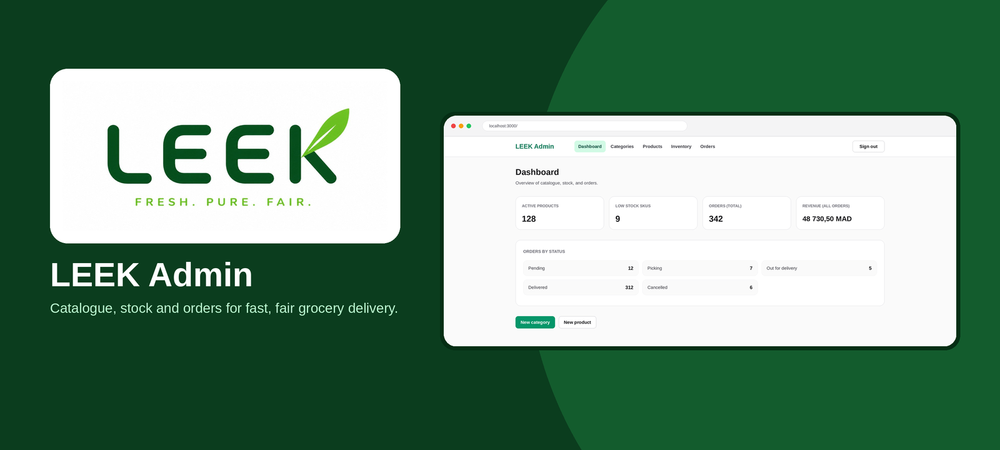
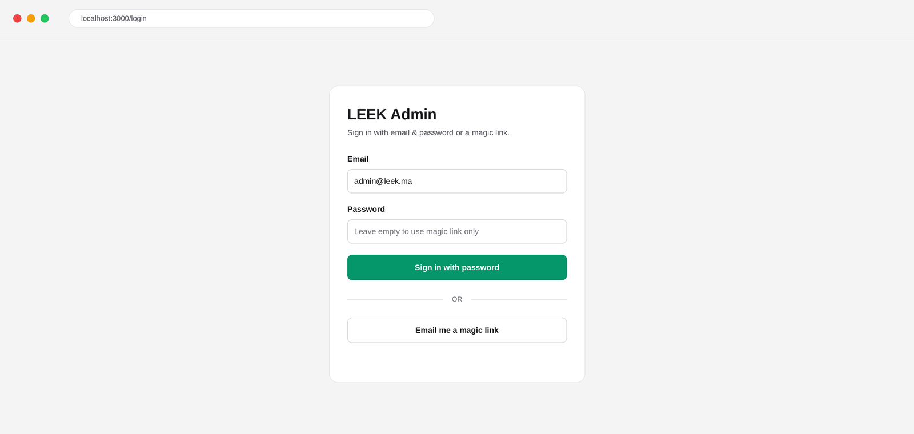
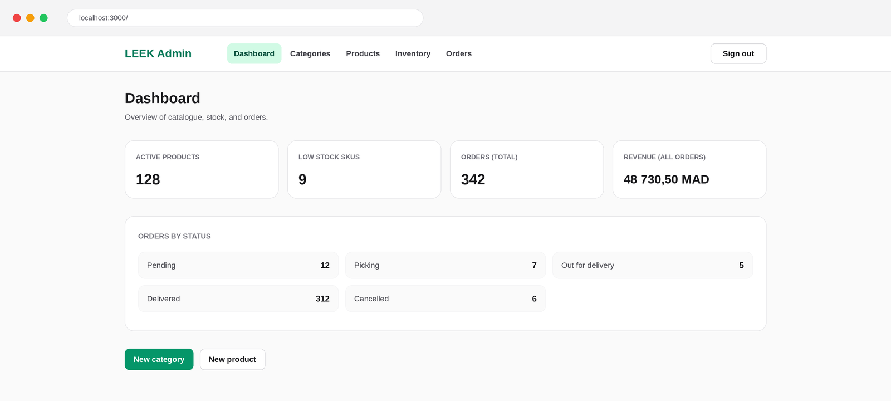
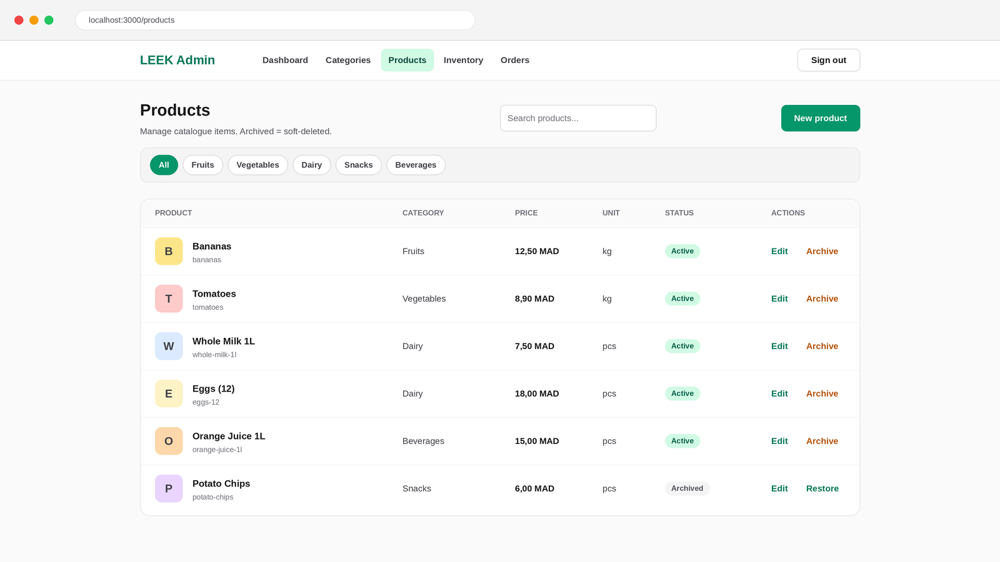
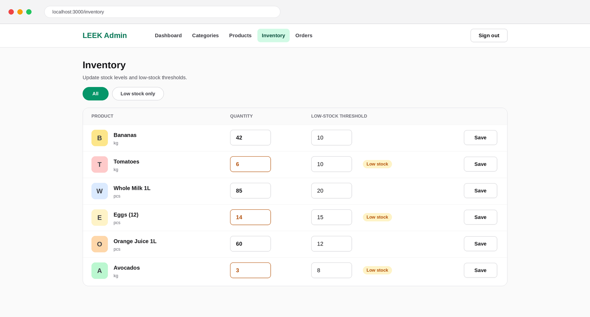
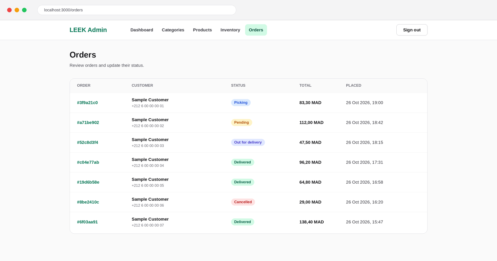
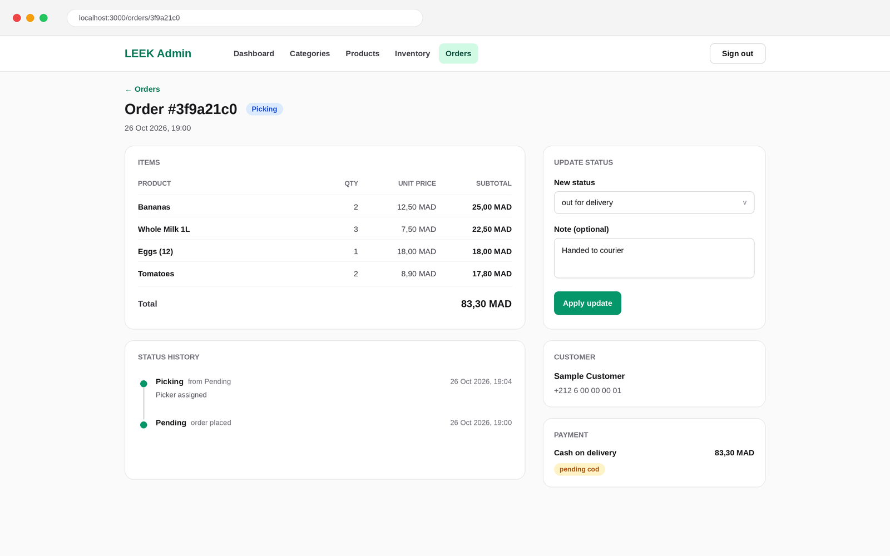

<p align="center">
  
</p>

<h1 align="center">LEEK Admin</h1>

<p align="center">
  The operations dashboard for <strong>LEEK</strong>, a quick-commerce grocery delivery service<br/>
  Manage the catalogue, track stock, and move orders from <em>pending</em> to <em>delivered</em>.
</p>

<p align="center">
  
  
  
  
  
</p>

---

## About

**LEEK** delivers fresh groceries at fair prices (*Fresh. Pure. Fair.*). Behind the customer app and the [landing page](https://github.com/walidwh21/leek_website) sits **LEEK Admin**: an internal web app used by the store team (a "dark store" operation) to keep the catalogue accurate, stock levels healthy, and orders moving

Only users registered as **admins** in Supabase can sign in. Everyone else is signed out and sent back to the login page

---

## Preview

| Login | Dashboard |
|---|---|
|  |  |

| Products | Inventory |
|---|---|
|  |  |

| Orders | Order detail |
|---|---|
|  |  |

---

## Features

| Area | What you can do |
|---|---|
| **Dashboard** | See active products, low-stock SKUs, total orders, revenue, and a count of orders per status at a glance |
| **Categories** | Create, edit, and order categories (position, slug, active/inactive) with an image |
| **Products** | Create and edit products (name, slug, description, price, unit, category), search by name, filter by category, **archive / restore** (soft delete) |
| **Inventory** | Update stock quantity and low-stock threshold per product, and filter to low-stock items only |
| **Orders** | List all orders with customer info, open an order to see its items, payment, customer profile and **status history**, and update status with an optional note |
| **Auth** | Email + password or magic link sign-in, admin-only access enforced on every request |
| **Images** | Upload to Supabase Storage or paste an external `http(s)` image URL |

### Order lifecycle

```
pending  →  picking  →  out_for_delivery  →  delivered
                  ↘            ↘
                    cancelled
```

Payment methods in the data model: `cod` (cash on delivery), `card`, `wire`

---

## Tech Stack

- **[Next.js 16](https://nextjs.org/)** (App Router, Server Components, Server Actions, middleware)
- **React 19** with the React Compiler enabled
- **TypeScript**
- **Tailwind CSS v4** (light and dark mode)
- **[Supabase](https://supabase.com/)**: Postgres, Auth, Storage (`@supabase/ssr`, `@supabase/supabase-js`)
- **ESLint 9** with `eslint-config-next`

---

## Project Structure

```
leek_admin/
├── app/
│   ├── (dashboard)/            # Protected admin area
│   │   ├── page.tsx            # Dashboard overview
│   │   ├── categories/         # List, new, [id]/edit, server actions, form
│   │   ├── products/           # List, new, [id]/edit, search toolbar, archive/restore
│   │   ├── inventory/          # Stock table and inline row form
│   │   ├── orders/             # Orders list, [id] detail, status form
│   │   ├── layout.tsx          # Admin shell (nav + Supabase setup guard)
│   │   ├── loading.tsx
│   │   └── error.tsx
│   ├── login/                  # Password and magic-link sign-in
│   ├── auth/callback/route.ts  # Magic-link code exchange
│   ├── layout.tsx              # Root layout (Geist fonts, metadata)
│   └── globals.css
├── components/
│   ├── admin-nav.tsx           # Top navigation and sign out
│   └── setup-supabase.tsx      # Shown when env vars are missing
├── lib/
│   ├── supabase/               # Server client, middleware session gate, auth cookie name
│   ├── supabaseClient.ts       # Browser client
│   ├── types/database.ts       # Row and enum types for the LEEK schema
│   ├── env.ts                  # Env check
│   ├── storage.ts              # Storage bucket name
│   └── utils.ts                # cn, slugify, formatMoney (MAD), formatDate
├── supabase/
│   └── schema.sql              # Reference schema, RPCs, RLS and storage policies
├── docs/
│   ├── leek_logo.jpg
│   └── screenshots/            # README preview images
├── .env.local.example          # Copy to .env.local
├── middleware.ts               # Runs the session check on every request
├── next.config.ts
├── postcss.config.mjs
└── package.json
```

---

## How Access Control Works

1. `middleware.ts` runs on every request and refreshes the Supabase session.
2. Unauthenticated visitors are redirected to `/login`
3. Signed-in users are checked with the Supabase RPC **`is_admin()`**. If it does not return `true`, the user is signed out and sent to `/login?error=unauthorized`
4. The auth cookie uses a project-specific name (`sb-<ref>-auth-token-leek-admin`), so the admin and the customer storefront never share a session on the same host
5. Magic-link sign-in does **not** create new accounts (`shouldCreateUser: false`). Admins must already exist in Supabase Auth

---

## Supabase Setup

This repo contains the admin front end. Your Supabase project needs:

| Needed | Details |
|---|---|
| **Tables** | `profiles`, `addresses`, `categories`, `products`, `inventory`, `orders`, `order_items`, `payments`, `order_status_history` (typed in [`lib/types/database.ts`](./lib/types/database.ts)) |
| **Admin check** | An `admins` table and an `is_admin()` function returning `boolean` |
| **Order RPC** | `update_order_status(p_order_id, p_new_status, p_note)` which updates the order and writes to `order_status_history` |
| **Storage** | A public bucket named `product-images` (or set `NEXT_PUBLIC_SUPABASE_STORAGE_BUCKET`) with admin upload policies |
| **RLS** | Row Level Security enabled, with admin access to the tables above |

[`supabase/schema.sql`](./supabase/schema.sql) contains all of this as a reference schema. If you already have a database, compare it against your own before running anything

---

## License

© LEEK. Walid Hattaoui.